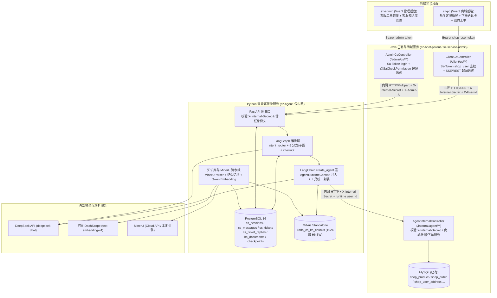
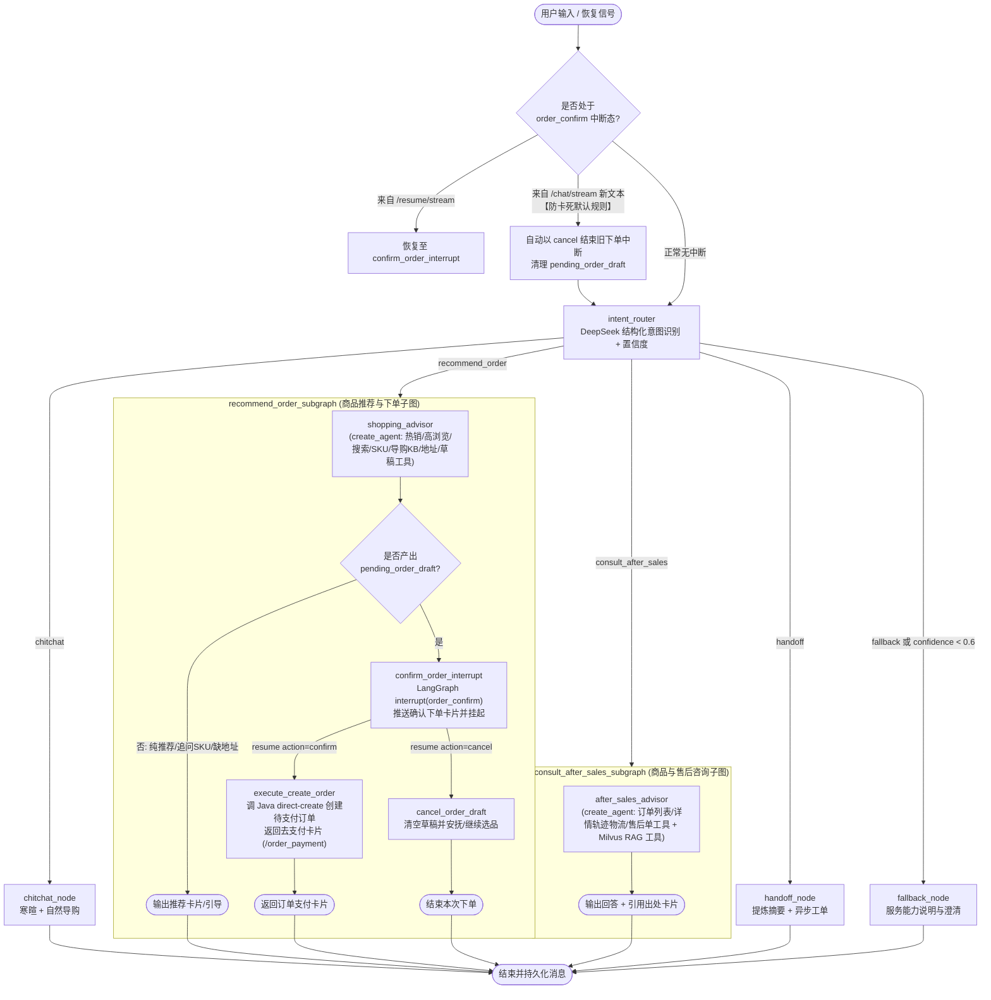

# 咔嗒造物商城（KlackCraft）智能客服 Agent 系统架构设计文档

> **日期**：2026-11-26  
> **目标模块**：新建 `sz-agent/`（Python 内网 AI 微服务）；改造 `sz-boot-parent`（`sz-service-admin`、`sz-common-security`、`config/{dev,local,preview,prod}/`）、`sz-pc`（PC 商城前端）、`sz-admin`（后台管理端）  
> **技术基线**：  
> - **Python 侧（`sz-agent`）**：Python 3.12+（`uv` 管理）、FastAPI、LangChain v1（`langchain.agents.create_agent` 统一模型与工具调用）、LangGraph（显式 `StateGraph` 主图路由 + 子图编排 + `AsyncPostgresSaver` 检查点与 `interrupt` 中断恢复）、SQLAlchemy 2.0（异步 + Alembic）、PostgreSQL 16、Milvus Standalone、MinerU、DeepSeek（`langchain-deepseek`）、阿里 Qwen Embedding（DashScope `text-embedding-v4`）。  
> - **Java & 前端侧**：Spring Boot 3 + Java 21（已开启虚拟线程）、Sa-Token（用户端 `shop_user` / 管理端 `login` 双体系隔离）、MyBatis-Flex、Vue 3 + TypeScript + Element Plus。  
> **选定架构**：**方案 B 演进版（客服数据全量落 PostgreSQL + Java 超薄鉴权透传 + 异步工单转人工 + 显式 LangGraph 主图路由与子图编排）**

---

## 1. 背景、目标、非目标与反目标

### 1.1 业务意图与背景
咔嗒造物商城（`sz-pc` 品牌标识 `KlackCraft / 咔嗒造物`，后端位于 `sz-boot-parent/sz-service/sz-service-admin`，后台位于 `sz-admin`）目前具备完整的商品、SKU、优惠券、限时秒杀、购物车、订单与售后闭环，但缺少智能客服入口。引入智能客服 Agent 的核心业务诉求有两点：
1. **售前导购提转化**：将客服定位为“懂外设与好物的商城顾问”，结合热销/高浏览商品主动导购，并在聊天窗口内闭环确认下单，缩短购买路径，提升用户消费转化。
2. **售后咨询降人力**：自动承接高频的订单状态查询、发货进度/物流追踪、售后进度查询，以及基于商城售后规则与《中华人民共和国消费者权益保护法》等权威法规的专业答疑，大幅减少人工客服重复工作量；对于确需人工介入的复杂诉求，通过异步工单沉淀给 `sz-admin` 后台处理。

### 1.2 核心目标
1. **跨栈强安全与会话严格隔离**：Java 商城与 Python Agent 凭证不互通，Python 服务仅运行于内网不对外暴露；Java 侧复用现有 Sa-Token 鉴权后透传可信 `user_id` / `admin_id`，Python 侧实现全链路会话、记忆、工具调用隔离。
2. **五大核心客服能力闭环**：
   - **闲聊导购**：处理寒暄与有限闲聊，自然引导回商城业务与选品购买；
   - **智能推荐与聊天内下单**：基于热销（`is_hot`、`sales`）与高浏览量（`browse`）推荐商品，支持在聊天中选定 SKU、数量、收货地址，通过 LangGraph `interrupt` 挂起确认后生成待支付正式订单并跳转 `/order_payment`；
   - **订单与法规售后咨询**：查询用户本人订单状态、轨迹（`shop_order_status`）、物流（`shop_express_info`）与售后单（`shop_order_after_sale`），并结合 Milvus 检索权威消保法规与商城服务规范作答；
   - **异步工单转人工**：自动提炼前情摘要创建工单写入 PostgreSQL，由 `sz-admin` 后台工单工作台异步审核、回复与关闭；
   - **兜底与澄清**：低置信度或越界输入时明确说明可提供的服务范围并引导用户澄清需求。
3. **客服数据全量落 PostgreSQL（零 MySQL 业务表侵入）**：会话、消息、工单、工单回复、知识库元信息与 LangGraph Checkpoint 全部存储在 PostgreSQL；Java MySQL 仅新增 1 份 Liquibase 菜单权限脚本用于 `sz-admin` 挂载菜单，不新增客服业务表。
4. **MinerU + Qwen Embedding + Milvus 知识库流水线**：收集整理消费者权益保护相关法律法规及商城售后规则 PDF，经 MinerU 解析为结构化 Markdown，切块后调用阿里 Qwen Embedding 向量化入 Milvus，并在 `sz-admin` 支持持续上传与重建。

### 1.3 非目标（Non-Goals）
- **不做双端实时同步聊天**：不改造 `sz-service-websocket`（9993 端口），不做人工坐席实时抢单与双端 WebSocket 长连接聊天，转人工统一走异步工单流转。
- **不在聊天内执行资金扣款/余额支付**：聊天内仅负责到“确认下单并生成待支付正式订单”，实际支付动作（余额 `yue`、微信 `wxpay`、支付宝 `alipay`）统一跳转商城现有 `/order_payment?orderNo=...` 页面完成。
- **不替代限时秒杀抢购**：秒杀并发锁与抢购资格校验仍由原商城秒杀页面与 `/client/shopOrder/flash/reserve` 承接，客服在推荐时如遇秒杀商品仅引导用户前往秒杀详情/活动页。
- **不赋予 Agent 越权写权限**：Agent 不可直接修改订单价格、直接审核通过售后、直接操作退款打款或修改他人数据。

### 1.4 反目标（Anti-Goals）
- **绝不发生跨用户串话或 IDOR 越权**：任何会话查询、工单查询、订单工具调用、Checkpoint 恢复都不允许用户 A 访问或操作用户 B 的数据。
- **绝不允许 Prompt Injection 诱导工具越权**：`user_id` 绝不作为大模型工具入参暴露；恶意输入如“帮我查 uid=1 的订单”必须在架构层被彻底免疫。
- **绝不编造虚假事实**：禁止大模型幻觉编造商品价格、库存、预计发货时间、物流节点或不存在的法律条文；查不到或未命中知识库必须如实说明。
- **绝不未经 `interrupt` 显式确认直接建单**：必须在 LangGraph `interrupt` 挂起后由前端显式点击确认并触发 `/resume/stream` 才能调用 Java 创建正式订单，禁止仅凭用户自然语言或模型猜测静默下单。
- **绝不阻塞 Java 请求线程**：Java 透传 SSE 禁止使用阻塞 `RestTemplate` 占满线程，必须利用虚拟线程 / 异步流式转发并正确处理客户端断连中止。

---

## 2. 架构方案对比与选型结论

在需求探讨过程中评估过三种技术方案：

| 维度 | 方案 A：Java 管会话与实时 SSE（MySQL）+ Python 专注 AI（PG+Milvus） | 方案 B（演进选定）：客服数据全落 PostgreSQL + Java 超薄鉴权透传 + 异步工单 | 方案 C：改造 `sz-service-websocket` 9993 统一 WS + Supervisor 调度 |
| :--- | :--- | :--- | :--- |
| **状态与数据存储** | 展示消息/会话在 MySQL，Checkpoint/KB 在 PG，跨库通过 `session_id` 关联 | **会话、消息、工单、KB、Checkpoint 全部在 PostgreSQL**，Java MySQL 零业务表 | MySQL + Redis Pub/Sub + PG |
| **Java 侧职责** | 维护会话与消息 CRUD、管人工接管状态切换、同步双写消息、转发 SSE | **超薄透传门面**：Sa-Token 鉴权后透传 `/client/cs/**` 与 `/admin/cs/**`，提供 `/internal/agent/**` | 需升级 9993 WS 拦截器并同时维护用户端与后台端连接 |
| **人工客服形态** | 实时在线工作台（双端 SSE 同步） | **异步工单工作台**（建单摘要 → 后台异步回复 → 用户端工单 Tab 查看/追问） | 实时在线工作台（WS 双工） |
| **AI 编排方式** | 显式 LangGraph 主图路由 + 专业子图 | **显式 LangGraph 主图路由 + 专业子图** | Supervisor 动态多 Agent 调度 |

### 选型结论与取舍理由
最终选定 **方案 B 演进版（PG 全量持久化 + Java 超薄透传 + 异步工单 + 显式 LangGraph 主图/子图）**：
1. **消除跨库一致性与长连接负担**：明确采用异步工单后，方案 B 原先“需透传双端实时长连接”的劣势消失；同时所有客服业务数据与 LangGraph Checkpoint 均落在同一 PostgreSQL 实例中，一次流式请求结束即可在同一个事务边界内同步更新 `cs_messages`、`cs_sessions` 与工单关联，无需 MySQL ↔ PG 双写协调。
2. **Java 侧侵入极小**：`sz-boot-parent` 无需引入新的业务表或重型消息状态机，只负责它最擅长的两件事——基于现有 `StpUserUtil` / `StpUtil` 做公网鉴权透传，以及向内网暴露带权属校验的 `/internal/agent/**` 商城数据接口。
3. **显式主图路由优于 Supervisor**：商城客服场景的 5 类意图边界清晰且对首字延迟、兜底可控性、转人工确定性要求高。采用显式 `intent_router` + 专业子图比 Supervisor 每轮额外调一次大模型调度更快、更省 Token，也更容易对“下单必须中断确认”和“法规回答必须有引用”做硬约束。

---

## 3. 总体系统架构与跨栈安全边界

### 3.1 总体系统架构图



### 3.2 四层跨栈安全与会话隔离防线

#### 防线 1：网络与端口隔离
- `sz-agent` 仅绑定内网地址（本地开发默认 `127.0.0.1:8000`，容器部署仅加入内部 Docker 网络，**不配置公网端口映射与 Nginx 公网路由**）。
- 所有公网用户与管理员请求必须经过 `sz-boot-parent` 的 Sa-Token 拦截链。

#### 防线 2：内网双向服务间鉴权（`X-Internal-Secret`）
- Java 调 Python（`/internal/cs/**`）以及 Python 工具反调 Java（`/internal/agent/**`）全部强制携带共享密钥请求头 `X-Internal-Secret`。
- 双方均使用常量时间比较（Python `hmac.compare_digest`，Java `MessageDigest.isEqual`）校验；密钥通过环境变量 `AGENT_INTERNAL_SECRET` 与 `sz-boot-parent/config/{dev,local,preview,prod}/agent.yml` 注入（严禁硬编码于源码或提交真实生产密钥）。
- **防伪造规则**：Java 转发前必须**主动移除或覆盖**客户端外部传入的任何 `X-Internal-Secret`、`X-User-Id`、`X-Admin-Id`、`X-Admin-Name`、`X-Request-Id` 请求头，再写入服务端解析出的可信身份。

#### 防线 3：Java 侧双身份隔离（复用 `SaTokenConfig`）
- **用户端 `/client/cs/**`**：命中 [SaTokenConfig.java](file:///Users/car/Project/library_system/sz-boot-parent/sz-common/sz-common-security/src/main/java/com/sz/security/config/SaTokenConfig.java) 中 `/client/**` 拦截链，强制校验 `StpUserUtil.checkLogin()` 与 `StpUserTokenRedisUtil.checkToken()`，通过 `StpUserUtil.getLoginIdAsLong()` 提取可信 `userId` 写入 `X-User-Id`。
- **管理端 `/admin/cs/**`**：命中管理端 `StpUtil.checkLogin()` 拦截链及控制器方法上的 `@SaCheckPermission(...)` 权限点校验，通过 `LoginUtils.getLoginUser()` 提取可信 `adminId` 与管理员名称，写入 `X-Admin-Id` 与 `X-Admin-Name`（非 ASCII 字符采用 URL 编码或 Base64 传输）。
- **内网回调用 `/internal/agent/**`**：在 `SaTokenConfig` 的两段路由拦截器中显式排除 `/internal/agent/**`，由专用 `AgentInternalAuthInterceptor` 独立校验 `X-Internal-Secret` 与来源配置。

#### 防线 4：Python 与 Java 纵深隔离（防 IDOR 与 Prompt Injection）
1. **不可预测会话/工单标识**：`cs_sessions.id` 与 `cs_tickets.id` 均采用 `UUIDv4`。Python 接口对所有 `/internal/cs/client/**` 操作强制附带 `WHERE id = :sid AND user_id = :uid` 校验，不匹配一律返回 `403/404`。
2. **LangGraph Thread 分区**：`thread_id` 固定由服务端拼接为 `f"u:{user_id}:s:{session_id}"`，前端传入的任何字段都无法覆盖 `user_id` 前缀。
3. **工具参数脱敏 + 运行时上下文注入（防 Prompt Injection）**：
   - 使用 LangChain v1 `create_agent(..., context_schema=AgentRuntimeContext)`；`AgentRuntimeContext` 包含 `user_id: int`、`session_id: str`、`trace_id: str`。
   - **所有工具函数的对外参数 Schema 中绝对不包含 `user_id`**；工具内部通过 LangChain `ToolRuntime[AgentRuntimeContext]`（`runtime.context.user_id`）获取可信 `user_id` 去请求 Java `/internal/agent/users/{userId}/...`。
4. **Java 内网接口二次权属校验**：即便 Python 传入了 `userId` 与 `orderNo` / `addressId`，Java `/internal/agent/**` 仍执行 `requireFrontOrder(orderNo, userId)` 与 `requireUserAddress(userId, addressId)` 复核，确保纵深防御。

---

## 4. LangChain + LangGraph 核心编排设计

### 4.1 统一模型、Embedding 与 `create_agent` 规范

1. **LLM（DeepSeek）**：使用 `langchain-deepseek` 的 `ChatDeepSeek`（`model="deepseek-chat"`，`api_key=DEEPSEEK_API_KEY`，`base_url=DEEPSEEK_BASE_URL`）。
   - 路由判定、结构化摘要提取：`temperature=0.0`，绑定 Pydantic `with_structured_output(..., method="json_schema" | "function_calling")`。
   - 闲聊、导购、售后问答：`temperature=0.3 ~ 0.6`，开启流式 `streaming=True`。
2. **Embedding（阿里 Qwen）**：使用 `langchain-openai` 的 `OpenAIEmbeddings` 连接 DashScope OpenAI 兼容接口（或封装等效客户端）：
   - `model="text-embedding-v4"`
   - `dimensions=1024`
   - `encoding_format="float"`
   - `check_embedding_ctx_length=False`（【默认决策】避免本地按 OpenAI tiktoken 分词误拦截中文文本或传 token 数组给 DashScope 兼容接口）
   - `base_url=DASHSCOPE_BASE_URL`（默认 `https://dashscope.aliyuncs.com/compatible-mode/v1`）
3. **Agent 构建（`create_agent`）**：
   - 使用 LangChain v1 标准工厂 `from langchain.agents import create_agent` 与 `ToolRuntime`（[Antigravity/LangChain context_schema 规范](https://docs.langchain.com)）：
     - `shopping_advisor_agent = create_agent(model=..., tools=[...], system_prompt=..., context_schema=AgentRuntimeContext)`
     - `after_sales_advisor_agent = create_agent(model=..., tools=[...], system_prompt=..., context_schema=AgentRuntimeContext)`
   - 运行时通过 `graph.astream(..., context=AgentRuntimeContext(...), config={"configurable": {"thread_id": thread_id}})` 向下传递可信上下文，既不在 Checkpoint 中序列化敏感运行态凭据，也确保工具可安全读取 `user_id`。

### 4.2 状态定义（`CustomerServiceState`）

```python
class OrderDraft(TypedDict):
    draft_id: str                 # 本次草稿唯一ID，同时作为下单幂等键前缀
    product_id: int
    product_name: str
    product_image: str
    sku_id: int
    sku_name: str
    unit_price: str               # 字符串十进制金额，避免浮点精度丢失
    quantity: int
    freight_price: str
    total_pay_price: str
    address_id: int | None
    receiver_name: str | None
    receiver_phone: str | None
    receiver_address: str | None
    available_addresses: list[dict]

class CustomerServiceState(TypedDict):
    messages: Annotated[list[AnyMessage], add_messages]
    intent: Literal["chitchat", "recommend_order", "consult_after_sales", "handoff", "fallback"] | None
    intent_confidence: float
    pending_order_draft: OrderDraft | None
    created_order: dict | None
    recommended_products: list[dict]
    created_ticket: dict | None
    rag_citations: list[dict]
    ui_events: list[dict]         # 本轮需推送给前端的结构化卡片/状态事件
```

### 4.3 主图路由与子图编排图



### 4.4 五大分支节点与子图详细规格

#### 1) 主图路由节点 `intent_router`
- 结合最近 6 轮对话历史与当前用户输入，通过 DeepSeek 输出结构化 `RouterDecision(intent, confidence, reason)`。
- **路由规则**：
  - `chitchat`：问候、寒暄、闲聊、表达情绪或模糊逛街。
  - `recommend_order`：咨询热销/热门商品、按品类/预算/用途找货、询问商品细节与价格、表达购买意愿、确认规格/数量/地址。
  - `consult_after_sales`：询问自己买的商品订单状态、何时发货、快递物流、如何退换货/退款、已提交售后单进度、七天无理由/质保/消费者合法权益条款咨询。
  - `handoff`：明确要求“转人工”“找人工客服”“人工处理”“我要投诉/工单”。
  - `fallback`：乱码、无意义符号、完全无关且无法归类的问题，或 `confidence < 0.6`。
- **【默认决策】防中断卡死规则**：当某会话此前因 `confirm_order_interrupt` 处于中断挂起态，但用户没有点击前端卡片按钮而是直接发送了一句新消息（例如“算了，换另一款键盘吧”或“查一下我之前的订单”）：
  - 服务端**绝不把自由文本当作确认下单依据**；
  - `/chat/stream` 入口检测当前 `thread_id` 存在待恢复中断时，先自动执行一次 `Command(resume={"action": "cancel", "reason": "superseded_by_new_message"})` 清理旧草稿并关闭挂起态，随后正常路由处理用户新消息。

#### 2) 闲聊导购节点 `chitchat_node`
- 以“咔嗒造物（KlackCraft）潮流外设与好物顾问”人设友好回应寒暄；
- 当闲聊偏向非商城话题（如天气、娱乐、写代码等）时，礼貌回应 1~2 句后自然拉回商城场景，例如主动询问偏好（如机械键盘、键帽、桌搭周边等）或顺带推荐当前热销/高人气好物，并附带可点击快捷引导词。

#### 3) 商品推荐与下单子图 `recommend_order_subgraph`
- **`shopping_advisor`（`create_agent`）绑定工具**：
  1. `list_hot_and_popular_products(sort_by="hot"|"sales"|"browse", category_id=None, limit=5)`：调 Java 内网接口获取上架商品（`is_show=1`），按热卖（`is_hot`）、销量（`sales`）、浏览量（`browse`）推荐；
  2. `search_products(keyword, category_id=None, min_price=None, max_price=None, limit=6)`：关键词检索上架商品；
  3. `get_product_detail_and_skus(product_id)`：读取商品详情、实时库存、全部 SKU 规格（`shop_product_attr_value`）与价格；
  4. `search_presale_kb(query, top_k=4)`【默认决策】：调用 Milvus 检索 `category in ["product_guide", "faq"]` 且 `scope == "public"` 的商品选购指南、参数兼容性与售前常见问答文档，回答时同步输出引用卡片；
  5. `list_user_addresses()`：通过 `runtime.context.user_id` 调 Java 拉取当前用户收货地址列表；
  6. `prepare_order_draft(product_id, sku_id, quantity=1, address_id=None)`：校验商品上架状态、SKU 有效性、库存充足性及用户地址可用性，计算商品总价与邮费，生成结构化 `OrderDraft` 写入状态。
- **下单前硬约束**：
  - 【默认决策】**秒杀商品拦截边界**：以 Java `ShopFlashSaleService.getAvailableByProductId(product_id, now)` 是否存在生效中的秒杀活动为准；若当前处于秒杀活动中，禁止聊天直接建单，提示用户前往秒杀活动页面抢购；非秒杀活动期间的普通上架商品允许走聊天直购。
  - 若库存不足（`stock < quantity`），禁止生成下单草稿并推荐同类有货热销商品；
  - 若用户账号下没有任何收货地址（`available_addresses` 为空），`shopping_advisor` 不进入中断建单，而是直接返回引导话术及前往 `/user/account/address` 新增地址的跳转提示；
  - 若商品存在多个 SKU 且用户未指明，先列出可选规格让用户确认，不得替用户盲选高价 SKU；若只有唯一默认 SKU 且用户明确说“买这个/帮我下单”，可自动锁定该 SKU。
- **`confirm_order_interrupt` 与 `execute_create_order`**：
  - 当 `pending_order_draft` 就绪时，进入 `confirm_order_interrupt`，调用 LangGraph `interrupt({"type": "order_confirm", "draft": draft})` 持久化检查点并发送 SSE `interrupt` 事件；
  - 用户在前端确认下单（可同时在卡片内切换 `address_id`）后，前端请求 `/client/cs/sessions/{sessionId}/resume/stream` 触发 `Command(resume={"action": "confirm", "address_id": selected_address_id})`；
  - `execute_create_order` 校验 `action == "confirm"` 后，使用 `idempotency_key = draft["draft_id"]` 调用 Java `POST /internal/agent/users/{userId}/orders/direct-create` 创建待支付正式订单（`status=0, paid=0`），并返回 `order_payment` 跳转卡片（`/order_payment?orderNo=...`）及倒计时提醒。

#### 4) 商品与售后咨询子图 `consult_after_sales_subgraph`
- **`after_sales_advisor`（`create_agent`）绑定工具**：
  1. `list_my_orders(tab="all"|"unpaid"|"wait_deliver"|"wait_receive"|"completed"|"refund", keyword=None, limit=5)`：通过 `runtime.context.user_id` 查询当前用户订单摘要；
  2. `get_my_order_detail(order_no)`：查询指定订单明细、当前状态中文描述（对应 `ShopOrderStatusEnum`）、订单状态时间轴（`shop_order_status`）、快递单号（`express_no`）及 `shop_express_info` 发货记录（收件信息、快递模板 ID、发货状态与发货时间），并附商城发货规则提示；
  3. `get_my_after_sale_status(order_no=None, service_no=None)`：查询用户的售后申请单（`shop_order_after_sale`）状态、审核意见（`audit_remark`）、退货物流与退款进度；
  4. `search_policy_and_law_kb(query, category=None, top_k=5)`：调用 Qwen Embedding + Milvus `kada_cs_kb_chunks` 检索消费者权益保护法规（`consumer_law`）、商城售后服务规范（`mall_policy`）及常见问答（`faq`）。
- **反幻觉与售后分流硬约束**：
  - 涉及订单状态与发货信息，必须以 `get_my_order_detail` / `list_my_orders` 真实返回为准；【默认决策】鉴于当前商城 `shop_express_info` 仅存储发货单号与发货记录、尚未接入第三方快递在途轨迹 API，若订单已发货且有 `express_no`，仅如实告知快递单号、发货时间及订单状态时间轴，明确提示暂不支持查询快递实时在途路由节点，严禁编造虚构物流节点；
  - 若用户未提供订单号且名下有多笔近期订单，先列出最近 3~5 笔供用户确认，或优先分析最新一笔并明确指出订单号；
  - **已付款未发货（`status=1`）退款分流边界**：维持现有 Java `ShopOrderAfterSaleServiceImpl` 与 `ShopOrderServiceImpl.canApplyAfterSale` 校验逻辑不变（目前仅 `已发货(status=2)` 与 `已收货(status=3)` 订单支持用户端自助发起售后申请）。当用户对“已付款待发货（`status=1`）”订单申请退款时，`after_sales_advisor` 如实告知该状态暂不支持前端自助售后通道，并引导转入 `handoff_node` 创建人工工单交由 `sz-admin` 后台人工处理退款；
  - 涉及七天无理由退货、质量瑕疵退换、运费承担、售后时效与消费者权益问题，必须先调用 `search_policy_and_law_kb`，在回答中标注依据的法规/规范名称与条款/章节，前端同时渲染可折叠引用卡片；若知识库未命中相关条款，诚实告知并建议转人工工单确认。

#### 5) 转人工节点 `handoff_node`
- 使用 DeepSeek 结构化提取 `HandoffSummary(category, title, summary, related_order_no)`：
  - `category` 枚举：`order_issue`（订单/发货）、`after_sale`（退换货/维权）、`product_consult`（商品定制/大单）、`complaint`（投诉建议）、`other`。
- **【默认决策】防空工单策略**：
  - 若最近对话已包含明确问题描述或关联订单号（或用户本句在“转人工”同时说明了诉求，如“帮我转人工，订单号 xxx 一直没发货”），立即创建 PG 工单 `cs_tickets`（状态 `OPEN`），把最近会话摘要、关联订单号及 `session_id` 写入工单，并向前端推送「已生成人工工单」卡片（含工单号与“查看我的工单”入口）；
  - 若用户是新会话首句且仅发送“转人工”三个字，没有任何上下文诉求，则先礼貌回复引导补充一句话问题描述或订单号，待下一轮确认后再建单（同时提供“直接提交空背景工单”快捷芯片兜底）。

#### 6) 兜底节点 `fallback_node`
- 当 `intent == "fallback"` 或 `intent_confidence < 0.6` 时触发；
- 明确列出客服可提供的 4 项能力（① 热销与个性商品推荐下单 ② 订单与发货/物流进度查询 ③ 售后政策与消费者权益法规解答 ④ 人工工单服务），并给出 1~2 句针对性澄清引导与快捷点击选项。

### 4.5 Checkpointer 持久化配置
- 使用官方 `langgraph-checkpoint-postgres` 的 `AsyncPostgresSaver` + `psycopg_pool.AsyncConnectionPool`。
- 应用启动生命周期（FastAPI `lifespan`）中初始化连接池并调用 `await checkpointer.setup()` 自动确保 LangGraph Checkpoint 表就绪。
- 每次图执行均传入 `configurable={"thread_id": f"u:{user_id}:s:{session_id}"}`，保证断线重连、页面刷新与下单中断恢复的强隔离与可追溯。

---

## 5. 知识库构建与 MinerU + Milvus 流水线

### 5.1 知识文档范围与初始化机制
1. **首批内置权威资料（存放于 `sz-agent/knowledge_docs/`）**：
   - 在实施阶段由开发侧检索权威原文并按已确认口径生成 4 份标准 PDF 存入 `sz-agent/knowledge_docs/`，随后经 MinerU 解析入 Milvus：
   - **法律法规类（`category="consumer_law"`）**：
     - 《中华人民共和国消费者权益保护法》（全国人大权威文本）；
     - 《中华人民共和国消费者权益保护法实施条例》（国务院令权威文本）；
     - 《网络购买商品七日无理由退货暂行办法》（市场监管总局权威文本）。
   - **商城服务规范类（`category="mall_policy"`）**：
     - 《咔嗒造物商城发货时效、运费与售后退换货服务规范》：结合仓库现有订单/售后/余额积分实现及已确认业务口径整理，明确：
       - **发货时效**：常规现货商品付款成功后 **48 小时内发货**（预售或客制化商品以商品详情页说明为准）；
       - **七天无理由退货规则**：签收次日起 7 日内支持无理由退货，**已拆封影响二次销售的轴体、键帽及个性化定制外设除外**（需保持商品及原包装完好）；
       - **退货运费承担**：因商品质量问题/错发漏发导致的退换货由**商家承担退货运费**，非质量问题七天无理由退货由**买家承担退货运费**；
       - **售后申请通道**：`已发货(status=2)`、`已收货(status=3)` 订单可在订单详情或「售后 / 退款」页面自助申请仅退款/退货退款；`已付款待发货(status=1)` 订单暂由客服转人工工单处理；退款原路/按商城规则退回余额与积分。
2. **双渠道入库**：
   - **离线初始化 CLI**：`uv run python -m app.kb.seed` 幂等扫描 `knowledge_docs/`，按 `file_sha256` 去重后自动完成 MinerU 解析与 Milvus 入库；
   - **后台在线管理**：支持在 `sz-admin`「客服知识库管理」上传新的 PDF，写入本地/持久化存储目录并触发 FastAPI `BackgroundTasks` 异步解析入库，在页面实时查看处理状态与切片数。

### 5.2 MinerU 解析适配器（`MinerUParser`）
运行与验收环境具备公网与 `DEEPSEEK_API_KEY`、`DASHSCOPE_API_KEY`、`MINERU_API_TOKEN` 凭据，主路径以 **`cloud_api`（Precision 模式）** 运行；同时抽象统一解析器 `MinerUParser`，通过环境变量 `MINERU_MODE` 支持多种解析后端切换【默认决策】：
- **`cloud_api`（主路径）**：对接 `mineru-open-sdk`。配置 `MINERU_API_TOKEN` 时自动使用高精模式（Precision Mode，支持复杂版面与表格转 HTML/Markdown）；若未配置 Token 降级使用免费 Flash 模式时，当单份 PDF 超过 Flash 页数/大小限制，自动按页拆分 PDF 为多个子片段分别提交后再合并 Markdown 作为兜底。
- **`local_http`**：对接自建/Docker 部署的 MinerU HTTP 解析服务（`MINERU_BASE_URL`）。
- **`local_cli`**：调用本机安装的 `magic-pdf` / `mineru` CLI 产出 Markdown。
- 解析产物统一落盘或缓存原始 Markdown，供排查切片质量与重新切块（无需重复调 MinerU）。

### 5.3 结构感知切块策略
1. 先对 MinerU 输出的 Markdown 做清洗（去除页眉页脚噪点、保留表格 Markdown/HTML 完整块）。
2. **法律与规范专属切分器**：
   - 一级切分按 Markdown 标题（`#`、`##`、`###`）提取 `section_path`（例如 `第三章 经营者的义务 > 第二十五条`）；
   - 二级切分识别中国法律常见条款正则（`^第[一二三四五六七八九十百千零〇0-9]+条`），尽量保证单条法条不被硬截断；
   - 三级按目标窗口 **500~800 字符**、重叠 **80~100 字符** 做递归合并/切分，超长表格单独保留或按行分段附带表头。

### 5.4 Milvus Collection 规格（`kada_cs_kb_chunks`）
- **Embedding 维度**：`1024`（匹配 Qwen `text-embedding-v4` `dimensions=1024`）。
- **Schema 字段**：
  - `chunk_id`：`VARCHAR(64)`（主键，非自增，格式 `{doc_id}:{chunk_index}`）
  - `doc_id`：`VARCHAR(36)`（对应 PG `kb_documents.id`）
  - `doc_title`：`VARCHAR(256)`（文档标题，如《消费者权益保护法》）
  - `category`：`VARCHAR(32)`（`consumer_law` / `mall_policy` / `faq` / `product_guide`）
  - `section_path`：`VARCHAR(512)`（章节/条款路径，用于回答引用展示）
  - `page_no`：`INT32`（起始页码，无页码填 `0`）
  - `scope`：`VARCHAR(32)`（固定 `"public"`，预留多租户/私有域隔离扩展）
  - `content`：`VARCHAR(4096)`（切片原文）
  - `embedding`：`FLOAT_VECTOR(1024)`
- **索引与检索**：
  - 向量索引：`HNSW`（`M=16, efConstruction=200`），度量类型 `COSINE`；
  - 检索固定过滤表达式：`scope == "public"`（指定分类时追加 `&& category == "{category}"`），`top_k=5`，附带余弦相似度阈值过滤（低于 `0.35` 的弱相关片段剔除并在上下文提示未命中强相关条文）。
- **一致性保障**：重建或删除某文档时，先在 Milvus 按 `doc_id == "{doc_id}"` 删除全部旧向量，再写入新向量或删除 PG `kb_documents` 记录，保证两库一致。

---

## 6. PostgreSQL 数据库表设计（SQLAlchemy 2.0 异步）

### 6.1 PostgreSQL 业务表（5 张表 + LangGraph 原生表）
所有表由 SQLAlchemy 2.0 `DeclarativeBase` 定义，配合 Alembic 管理表结构迁移（LangGraph Checkpointer 表由 `AsyncPostgresSaver.setup()` 管理）。

| 表名 | 核心字段与类型 | 索引与约束 | 说明 |
| :--- | :--- | :--- | :--- |
| **`cs_sessions`** | `id` (UUID PK), `user_id` (BIGINT NOT NULL), `title` (VARCHAR(128)), `status` (VARCHAR(16): `ACTIVE` / `ARCHIVED`), `has_pending_interrupt` (BOOLEAN DEFAULT FALSE), `last_intent` (VARCHAR(32)), `last_message_at` (TIMESTAMPTZ), `created_at` (TIMESTAMPTZ), `updated_at` (TIMESTAMPTZ) | `idx_cs_sessions_user_time(user_id, last_message_at DESC)` | 会话主表；所有客户端读写必带 `user_id` 过滤 |
| **`cs_messages`** | `id` (UUID PK), `session_id` (UUID FK -> `cs_sessions.id` ON DELETE CASCADE), `user_id` (BIGINT NOT NULL), `role` (VARCHAR(16): `user` / `assistant` / `system`), `content` (TEXT), `intent` (VARCHAR(32)), `cards_json` (JSONB), `citations_json` (JSONB), `interrupt_payload` (JSONB), `created_at` (TIMESTAMPTZ) | `idx_cs_messages_session_time(session_id, created_at ASC)` | 展示用消息流水表（支撑历史回放、后台工单查看上下文及结构化卡片还原） |
| **`cs_tickets`** | `id` (UUID PK), `ticket_no` (VARCHAR(32) UNIQUE, 如 `TK202611260001`), `user_id` (BIGINT NOT NULL), `session_id` (UUID FK -> `cs_sessions.id`), `category` (VARCHAR(32)), `title` (VARCHAR(128)), `summary` (TEXT), `related_order_no` (VARCHAR(64)), `status` (VARCHAR(16): `OPEN` / `REPLIED` / `CLOSED`), `last_reply_at` (TIMESTAMPTZ), `closed_at` (TIMESTAMPTZ), `created_at` (TIMESTAMPTZ), `updated_at` (TIMESTAMPTZ) | `idx_cs_tickets_user(user_id, created_at DESC)`；`idx_cs_tickets_status(status, updated_at DESC)` | 异步人工客服工单主表 |
| **`cs_ticket_replies`** | `id` (UUID PK), `ticket_id` (UUID FK -> `cs_tickets.id` ON DELETE CASCADE), `sender_type` (VARCHAR(16): `USER` / `ADMIN`), `sender_id` (BIGINT NOT NULL), `sender_name` (VARCHAR(64)), `content` (TEXT NOT NULL), `created_at` (TIMESTAMPTZ) | `idx_cs_ticket_replies_ticket(ticket_id, created_at ASC)` | 工单双向异步回复流水（管理员回复 + 用户追问） |
| **`kb_documents`** | `id` (UUID PK), `title` (VARCHAR(256) NOT NULL), `category` (VARCHAR(32) NOT NULL), `file_name` (VARCHAR(256)), `file_path` (VARCHAR(512)), `file_sha256` (VARCHAR(64) UNIQUE), `file_size` (BIGINT), `mineru_mode` (VARCHAR(32)), `status` (VARCHAR(16): `PENDING` / `PARSING` / `INDEXED` / `FAILED`), `chunk_count` (INT DEFAULT 0), `error_msg` (TEXT), `uploaded_by` (BIGINT), `created_at` (TIMESTAMPTZ), `updated_at` (TIMESTAMPTZ) | `uk_kb_doc_sha256(file_sha256)`；`idx_kb_doc_status(status)` | 知识库 PDF 文档台账（防重复上传与失败重试） |

### 6.2 工单状态机与会话回写规则
- 状态流转：
  - Agent 转人工建单 → `OPEN`；
  - `sz-admin` 管理员回复工单 → 状态转为 `REPLIED`（若管理员勾选“回复并关闭”或单独点关闭 → `CLOSED`）；
  - 用户在「我的工单」继续追问（仅 `OPEN` / `REPLIED` 允许追问）→ 写入 `cs_ticket_replies(sender_type="USER")` 并将 `cs_tickets.status` 重新置为 `OPEN`，进入管理员待处理队列。
- **回复同步可见性**：管理员在 `sz-admin` 提交工单回复时，除写入 `cs_ticket_replies` 外，若工单关联了 `session_id`，同步向 `cs_messages` 追加一条 `role="system"` 的工单回复摘要消息（含工单号与回复内容），使用户回到「在线咨询」或「我的工单」都能看到完整衔接。

### 6.3 Java MySQL 变更约束
- **不新增任何客服业务表**。
- 仅在 `sz-boot-parent/sz-service/sz-service-admin/src/main/resources/db/changelog/business/` 新增 1 份 Liquibase 增量 SQL（遵循现有 `shop_system` 菜单结构），为 `sz-admin` 管理员注册两个二级菜单及权限码：
  - 「客服工单管理」（路由 `/shop/cs-ticket`，组件 `shop_system/csTicket/index`，权限 `cs.ticket.query_table`、`cs.ticket.reply`、`cs.ticket.close`）
  - 「客服知识库管理」（路由 `/shop/cs-knowledge`，组件 `shop_system/csKnowledge/index`，权限 `cs.kb.query_table`、`cs.kb.upload`、`cs.kb.delete`）

---

## 7. 跨端接口契约（Java 透传 + Java 内网数据 + SSE 协议）

### 7.1 Java 用户端超薄透传接口（`/client/cs/**`）
位于 `sz-service-admin` `ClientCsController`，全部走 `SaTokenConfig` `/client/**` 校验，统一提取 `StpUserUtil.getLoginIdAsLong()` 作为可信 `X-User-Id` 转发给 `sz-agent`：

| Java 公网路径 | 方法 | 转发至 Python 内网路径 | 说明 |
| :--- | :--- | :--- | :--- |
| `/client/cs/sessions` | `GET` / `POST` | `GET/POST /internal/cs/client/sessions` | 获取当前用户会话列表 / 新建会话 |
| `/client/cs/sessions/{sessionId}/messages` | `GET` | `GET /internal/cs/client/sessions/{sessionId}/messages` | 拉取历史消息（含卡片与未完成中断态还原） |
| `/client/cs/sessions/{sessionId}/chat/stream` | `POST` | `POST /internal/cs/client/sessions/{sessionId}/chat/stream` | 发起对话，返回 `text/event-stream` SSE |
| `/client/cs/sessions/{sessionId}/resume/stream` | `POST` | `POST /internal/cs/client/sessions/{sessionId}/resume/stream` | 提交 `action=confirm/cancel` 与 `addressId` 恢复下单中断，返回 SSE |
| `/client/cs/tickets` | `GET` | `GET /internal/cs/client/tickets` | 我的工单分页列表（支持状态筛选） |
| `/client/cs/tickets/{ticketId}` | `GET` | `GET /internal/cs/client/tickets/{ticketId}` | 工单详情与回复流水 |
| `/client/cs/tickets/{ticketId}/replies` | `POST` | `POST /internal/cs/client/tickets/{ticketId}/replies` | 用户对 `OPEN`/`REPLIED` 工单补充追问 |

- **SSE 流式透传工程规范（利用 JDK 21 虚拟线程）**：
  - 使用 Java 标准 `java.net.http.HttpClient`（或 Spring `WebClient`）建立流式连接，配合 `SseEmitter(300_000L)` 在虚拟线程中逐行读取 Python SSE 事件并实时 `emitter.send(...)` 给前端；
  - 显式设置响应头 `Cache-Control: no-cache`、`X-Accel-Buffering: no`；
  - 绑定 `emitter.onCompletion` / `emitter.onTimeout` / `emitter.onError` 回调，一旦前端断开或超时，**立即取消/关闭向 Python 的底层 HTTP 流**，Python 端监听 `await request.is_disconnected()` 中止后续生成与落库脏数据。

### 7.2 Java 管理端超薄透传接口（`/admin/cs/**`）
位于 `sz-service-admin` `AdminCsController`，走管理端 `StpUtil` + `@SaCheckPermission`，剥离客户端伪造头后注入 `X-Admin-Id` 与 `X-Admin-Name` 透传给 `sz-agent`：

| Java 公网路径 | 方法 | 权限码 | 转发至 Python 内网路径 | 说明 |
| :--- | :--- | :--- | :--- | :--- |
| `/admin/cs/tickets` | `GET` | `cs.ticket.query_table` | `GET /internal/cs/admin/tickets` | 工单分页查询（状态/分类/订单号/关键词） |
| `/admin/cs/tickets/{ticketId}` | `GET` | `cs.ticket.query_table` | `GET /internal/cs/admin/tickets/{ticketId}` | 工单详情（含摘要、回复流水、关联会话消息回放） |
| `/admin/cs/tickets/{ticketId}/reply` | `POST` | `cs.ticket.reply` | `POST /internal/cs/admin/tickets/{ticketId}/reply` | 管理员异步回复（可选同时关闭工单） |
| `/admin/cs/tickets/{ticketId}/close` | `POST` | `cs.ticket.close` | `POST /internal/cs/admin/tickets/{ticketId}/close` | 关闭工单 |
| `/admin/cs/kb/documents` | `GET` | `cs.kb.query_table` | `GET /internal/cs/admin/kb/documents` | 知识库文档分页列表 |
| `/admin/cs/kb/documents/upload` | `POST` | `cs.kb.upload` | `POST /internal/cs/admin/kb/documents/upload` | Multipart 上传 PDF 并触发异步解析入库 |
| `/admin/cs/kb/documents/{docId}/reindex` | `POST` | `cs.kb.upload` | `POST /internal/cs/admin/kb/documents/{docId}/reindex` | 失败重试或重新解析入库 |
| `/admin/cs/kb/documents/{docId}` | `DELETE` | `cs.kb.delete` | `DELETE /internal/cs/admin/kb/documents/{docId}` | 删除文档（同步清理 Milvus 向量与 PG 记录） |

### 7.3 Java 内网商城数据接口（`/internal/agent/**`）
由 `AgentInternalController` 提供，仅内网调用（`AgentInternalAuthInterceptor` 校验 `X-Internal-Secret`）。由于现有 `ShopOrderServiceImpl`、`ShopUserAddressServiceImpl` 多处直接调用 `StpUserUtil.getLoginIdAsLong()` 读取登录态，需在不破坏原有 `/client/**` 行为的前提下，将对应逻辑抽取出带显式 `long userId` 参数的内部服务方法供 `/internal/agent/**` 复用：

| 内网路径 | 方法 | 用途与实现要点 |
| :--- | :--- | :--- |
| `/internal/agent/products/recommend` | `GET` | 支持 `sort=hot\|sales\|browse`、`categoryId`、`limit`，筛选 `is_show=1 AND is_del=0 AND stock > 0`，优先返回热卖/高销量/高浏览商品 |
| `/internal/agent/products/search` | `GET` | 支持 `keyword`、`categoryId`、`minPrice`、`maxPrice`、`limit`，检索上架商品 |
| `/internal/agent/products/{productId}` | `GET` | 返回商品主信息、简介与全量有效 SKU 列表（`shop_product_attr_value` 含 `skuId`, `sku`, `price`, `stock`, `image`） |
| `/internal/agent/users/{userId}/addresses` | `GET` | 查询 `shop_user_address` 下 `uid == userId` 的有效收货地址（默认地址排第一） |
| `/internal/agent/users/{userId}/orders` | `GET` | 查询 `uid == userId` 的订单列表摘要（复用 `ShopOrderServiceImpl` 状态映射与 Tab 过滤） |
| `/internal/agent/users/{userId}/orders/{orderNo}` | `GET` | 复核 `order.uid == userId`；返回订单明细、`ShopOrderStatusEnum` 中文状态、状态轨迹（`shop_order_status`）、快递单号（`express_no`）与 `shop_express_info` 发货记录（发货状态、快递模板、发货时间）及关联售后单（`shop_order_after_sale`） |
| `/internal/agent/users/{userId}/after-sales` | `GET` | 查询 `uid == userId` 的售后单列表或按 `orderNo` / `serviceNo` 过滤，返回 `ShopOrderAfterSaleStatusEnum` 状态与审核备注 |
| `/internal/agent/users/{userId}/orders/direct-create` | `POST` | **聊天确认下单专用幂等接口**：入参 `{productId, skuId, quantity, addressId, idempotencyKey}`。先用 Redis `shop:agent:order:idemp:{userId}:{idempotencyKey}` 防重复提交；【默认决策】库存扣减沿用商城普通订单现行约定——建单时仅校验商品上架、非生效中秒杀活动、SKU 属于该商品、当前库存 `stock >= quantity` 及地址归属该 `userId`，不提前预扣库存（仍由原 `/client/shopOrder/order/payment` 支付成功时统一 `deductOrderStock`，`expireOrder` 逻辑无需改动）；写入 `shop_order`（`paid=0, status=0, seckillId=0`）并初始化订单支付倒计时（`initializeOrderPaymentCountdown`），返回 `{orderNo, payPrice, remainingSeconds, paymentUrl: "/order_payment?orderNo=..."}` |

### 7.4 统一 SSE 事件协议
Python 输出与 Java 透传完全保持以下标准 `event:` + JSON `data:` 格式：
- `event: meta`：`{"session_id": "...", "message_id": "...", "intent": "recommend_order"}`
- `event: token`：`{"delta": "为您推荐..."}`（增量文本流）
- `event: card`：`{"card_type": "product_list" | "order_created" | "ticket_created" | "citations", "payload": {...}}`
- `event: interrupt`：`{"interrupt_type": "order_confirm", "session_id": "...", "payload": {OrderDraft...}}`（收到该事件后流进入等待状态并结束本次 SSE 响应）
- `event: done`：`{"message_id": "...", "finish_reason": "stop" | "interrupted"}`
- `event: error`：`{"code": "...", "message": "服务暂时繁忙，请稍后再试或转人工工单"}`

---

## 8. `sz-pc` 与 `sz-admin` 交互设计

### 8.1 `sz-pc` 前台商城悬浮智能客服
- **挂载方式**：在 [App.vue](file:///Users/car/Project/library_system/sz-pc/src/App.vue) 全局挂载 `<CustomerServiceWidget />`，仅在 `/login` 路由隐藏，保证用户浏览首页、商品详情、订单中心时随时可呼出，且不打断当前页面浏览。
- **【默认决策】未登录引导**：当用户未登录（`!authStore.isLogin`）点击悬浮客服按钮时，提示“登录后即可为您推荐好物、查询订单与专属售后”，引导跳转 `/login?redirect=<当前页面完整路径>`，登录后自动返回并可打开客服抽屉。
- **双 Tab 抽屉界面**：
  1. **「在线咨询」Tab**：
     - 顶部会话切换/新建会话按钮；
     - 首屏欢迎语 + 快捷提问芯片（如“推荐热销外设”“查我最近的订单什么时候发货”“七天无理由怎么退”“联系人工客服”）；
     - 流式打字渲染区，支持 4 类结构化富媒体卡片：
       - **商品推荐卡**：展示封面、名称、价格、销量/热度标签，提供「查看详情」（跳转 `/product/:id`）与「帮我买这件」（填入对话触发选规格流程）；
       - **下单确认卡（LangGraph `interrupt`）**：展示商品名、SKU、数量、商品金额、运费、实付总价，支持下拉/弹层切换当前用户的收货地址，底部提供「确认提交订单」与「暂不下单」按钮（按钮提交后置灰防连点，调用 `/client/cs/sessions/{id}/resume/stream`）；
       - **待支付订单卡**：显示订单号、应付金额、支付倒计时提醒，提供「立即去支付」按钮（`router.push({ path: '/order_payment', query: { orderNo } })`）；
       - **法规/规范引用折叠条**：展示本条回答参考的《消保法》或商城规范文档名、条款路径及摘要。
  2. **「我的工单」Tab**：
     - 展示通过转人工生成的工单列表与状态标签（待处理 `OPEN` / 已回复 `REPLIED` / 已关闭 `CLOSED`）；
     - 点击查看客服回复详情，支持在 `OPEN` / `REPLIED` 状态下继续补充追问。

### 8.2 `sz-admin` 后台管理页面
1. **「客服工单管理」（`sz-admin/src/views/shop_system/csTicket/index.vue`）**：
   - 沿用 `sz-admin` 现有 ProTable / Element Plus 表格规范，支持按状态（`OPEN`/`REPLIED`/`CLOSED`）、分类、工单号、订单号筛选；
   - 点击「处理/查看」打开右侧抽屉：上半区展示工单号、用户 ID、AI 提炼的前情摘要与关联订单号，中段折叠展示触发工单时的历史对话上下文，下半区展示回复时间轴与管理员回复表单（支持“发送回复”及“回复并关闭工单”）。
2. **「客服知识库管理」（`sz-admin/src/views/shop_system/csKnowledge/index.vue`）**：
   - 支持上传 PDF 文件并选择分类（`consumer_law` / `mall_policy` / `faq` / `product_guide`）与标题；
   - 表格展示文档名称、分类、MinerU 解析模式、状态徽标（`PENDING`/`PARSING`/`INDEXED`/`FAILED`）、切片数量、失败原因及更新时间；
   - 支持状态轮询刷新、失败「重新解析入库」以及「删除」（二次确认后联动清理 Milvus 与 PG）。

---

## 9. 运行环境、依赖配置与留待实现阶段决定的细节

### 9.1 `sz-agent` 工程结构与运行环境
- **包管理与目录**：独立位于仓库根目录 `/Users/car/Project/library_system/sz-agent/`，使用 `uv` + Python `>=3.12` 管理依赖（`pyproject.toml` + `uv.lock`），与 `sz-boot-parent` / `sz-pc` / `sz-admin` 平级。
- **核心依赖**：`fastapi`, `uvicorn[standard]`, `pydantic-settings`, `httpx`, `sqlalchemy[asyncio]`, `asyncpg`, `alembic`, `psycopg[binary]`, `psycopg-pool`, `langchain>=1.0`, `langgraph`, `langgraph-checkpoint-postgres`, `langchain-deepseek`, `langchain-openai`, `pymilvus`, `mineru-open-sdk`。
- **基础设施编排**：在 `sz-agent/docker-compose.yml` 提供本地一键依赖环境（`postgres:16` + `milvus-standalone` + `etcd` + `minio`），开箱支持本地全链路验证。
- **环境变量清单（`sz-agent/.env.example`）**：
  - 服务与安全：`APP_HOST=127.0.0.1`, `APP_PORT=8000`, `AGENT_INTERNAL_SECRET`, `JAVA_INTERNAL_BASE_URL=http://127.0.0.1:9991`, `JAVA_INTERNAL_TIMEOUT_SECONDS=15`
  - 数据库与向量库：`POSTGRES_DSN`, `MILVUS_URI=http://127.0.0.1:19530`, `MILVUS_COLLECTION=kada_cs_kb_chunks`
  - 大模型与向量模型：`DEEPSEEK_API_KEY`, `DEEPSEEK_BASE_URL=https://api.deepseek.com`, `DEEPSEEK_MODEL=deepseek-chat`, `DASHSCOPE_API_KEY`, `DASHSCOPE_BASE_URL=https://dashscope.aliyuncs.com/compatible-mode/v1`, `QWEN_EMBEDDING_MODEL=text-embedding-v4`, `QWEN_EMBEDDING_DIMENSIONS=1024`
  - MinerU：`MINERU_MODE=cloud_api`, `MINERU_API_TOKEN`, `MINERU_BASE_URL`, `KB_STORAGE_DIR=./storage/kb_docs`

### 9.2 留待实现阶段决定的细节（What's Left to the Builder）
以下工程细节不影响整体架构边界与产品行为，留待 `writing-plans` 与编码阶段按仓库惯例自行敲定：
1. System Prompt 具体措辞细节、欢迎语文案、快捷引导芯片示例文本及少样本路由示例。
2. `sz-agent` 内部包模块划分、Alembic 迁移脚本初始化组织、FastAPI 依赖注入组织及 SSE 心跳保活间隔（建议 15s comment ping）。
3. `sz-pc` 悬浮气泡与抽屉的具体视觉像素细节（需贴合 `sz-pc` 现有 `kc-*` 主题风格）及 Markdown 轻量渲染组件选型。
4. 单元测试与集成测试的 Mock 策略（如 Mock DeepSeek / DashScope / MinerU 覆盖路由、工具上下文注入 `user_id` 防越权、下单 `interrupt` 恢复及防卡死清理逻辑）。
